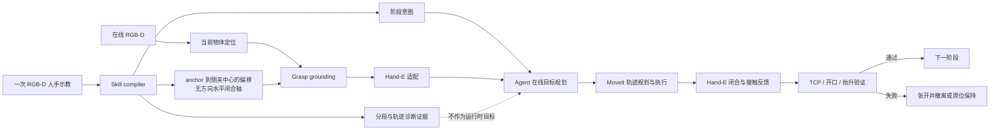

# Refined one-time-demonstration real-robot framework

本文记录 2026-10-21 真机调试后确定的框架。当前系统已经在 **FR3 + Robotiq
Hand-E + 固定 D435** 上完成一次真实的骰子抓取和 40 mm 抬升。它不是让模型直接产生
关节命令，而是把一次人手示教编译成可检查的阶段意图和侧夹相对几何。agent 在运行时
选择各运动阶段的目标，MoveIt 规划到目标的机器人轨迹，确定性状态机和夹爪驱动负责执行与验证。



## 核心分工

- **人手示教**提供任务阶段意图，以及拇指和食指形成侧夹时的相对关系：物体 anchor 到
  捏合中心的偏移与无方向的水平闭合轴。它不提供机器人自由空间运动目标，也不直接控制
  机械臂关节。`a` 和 `-a` 表示同一条夹爪闭合线。
- **在线感知**回答“物体现在在哪里”，并检查多帧稳定性、尺寸和工作空间边界。
- **robot-specific Hand-E 适配**在示教关系落地以后补入 TCP 高度、可用开口、末端变换、
  支撑面和碰撞模型等当前机器人的约束。它与人手示教关系是两个独立层次。
- **agent**根据阶段意图、当前实测状态、可见性和净空在线生成
  `APPROACH/LIFT/PLACE/RETREAT` 目标，并依据 predicate 选择继续、重观测、重规划或恢复。
- **MoveIt**负责 IK、碰撞检查，以及从实测状态到 agent 目标的低速轨迹规划与执行。
- **确定性执行器**按照固定阶段推进，并在每一步检查测量反馈；LLM 不在伺服回路内，
  也不逐点输出关节命令。
- **通用 agentic 合同**可以根据阶段目标、相对几何和 predicate 表达继续、重观测、
  重规划或恢复。当前真机 runner 的自主分支更窄：`PREGRASP` 前从实测状态重新规划，
  下降时闭环修正，接触前失败则张开并上撤后终止；它不会自动重新观测并重试整项任务。

## 1. 离线：把一次示教编译成 skill

入口是 `scripts/compile_agentic_skill.py`，数据结构在
`src/demo2gripper/task_skill.py`。当前示教产物位于：

```text
runs/live/quick_chain_validation_20261021/demo_01/agentic_skill_prototype/
  agentic_skill.json
  trajectory.npz
  compiler_report.json
  preview.png / preview.mp4
```

示教仍会被分成以下阶段，但运动轨迹只保留为分段和质量检查证据：

| 阶段 | 帧区间 | 编译后的运行时含义 |
|---|---:|---|
| `APPROACH` | `[130, 182)` | 靠近意图；目标由 agent 在线生成 |
| `PRESHAPE` | `[182, 186)` | 接触前整形意图；目标由 agent 在线生成 |
| `GRASP` | `[186, 264)` | anchor 到侧夹中心的偏移和无方向水平闭合轴 |
| `LIFT` | `[264, 280)` | 抓取后建立净空的意图；目标由 agent 在线生成 |
| `PLACE` | `[280, 377)` | 放置意图；目标由 agent 根据任务放置区在线生成 |
| `RELEASE` | `[377, 383)` | 释放意图 |
| `RETREAT` | `[383, 388)` | 释放后安全撤离的意图；目标由 agent 在线生成 |

该示教没有可靠地分出独立 `TRANSPORT` 段。通用 `TaskSkill` 仍标为
`review_only`；当前真机 runner 使用其中经过检查的几何证据，但尚未成为可执行任意
`TaskSkill` 的通用解释器。

`trajectory.npz` 保存上述分段所用的人手与物体轨迹，用于检查连续性、支撑面净空、
手物同步和阶段边界。它只是诊断证据，不能成为运行时 TCP 目标或 MoveIt waypoint。
当前 runner 的竖直接近 `80 mm` 和向上抬升 `40 mm` 是第一版确定性 agent 策略；它们
不是对示教路径的回放。`PLACE/RELEASE/RETREAT` 尚未执行。

当前 `ObjectGraspRelation` 是 `base_aligned_planar`：

- 物体中心到人手抓取中心的平移为
  `[-0.001334, +0.002523, -0.000791] m`；
- 示教闭合轴约为 `[0.915869, 0.387462, 0.105150]`，关系中保存去掉竖直分量并归一化后的
  `[0.920975, 0.389622, 0]`。这是无方向的 jaw line，符号翻转不改变侧夹约束；
- 示教接近方向仅作为诊断证据；第一版 agent 策略采用基座 `-Z` 竖直下降；
- 人手捏合宽度 `42.08 mm` 只表达示教几何，不直接作为 Hand-E 的开口命令。

当前在线 anchor 不包含物体方向。因此，这一版能把物体的**平移**迁移到抓取目标，也能
用于方向不影响任务的对称骰子；它不能随任意旋转的物体一起旋转侧夹关系。后者需要点云
模板配准或其他 6D 位姿估计得到 `T_base_object`，再使用真正的 `T_object_tcp`。

## 2. 在线：从 RGB-D 定位当前物体

`scripts/capture_realsense_rgbd.py` 从序列号 `254622073804` 的 D435 保存 RGB、对齐的
米制深度、内参和硬件时间戳。`scripts/localize_supported_object.py` 和
`src/demo2gripper/supported_object.py` 使用 `T_base_camera` 把深度点变换到 FR3 基座。

当前快速真机路径使用支撑面上方的主三维连通区域定位骰子，Run 05 没有使用 SAM3。
系统连续检查 5 帧的中心、点数、稳健包围盒和支撑面高度。最终实跑配置在
`runs/live/autonomous_pick_20261021_config.json`；去掉机器路径和设备编号的可复现模板为
`configs/autonomous_pick.example.json`。主要限制为：

- 观测工作空间：`[0.62, 0.015, -0.02]` 到 `[0.678, 0.09, 0.08] m`；
- 支撑面带：`z = [-0.015, 0.03] m`，物体点至少高出支撑面 `8 mm`；
- 中心最大/均方根帧间偏差：`3/2 mm`；点数变异系数不超过 `0.1`；
- anchor 高度：`42–52 mm`；物体露出支撑面的高度：`24–40 mm`；
- 物体稳健尺寸范围：`[25,14,14]` 到 `[45,35,24] mm`。

Run 05 得到的当前物体 anchor 是
`[0.658898, 0.072096, 0.047576] m`。稳健包围盒约为
`39.51 × 30.78 × 19.02 mm`；5 帧点数为 `[1282,1285,1269,1368,1265]`，中心最大
偏差 `2.148 mm`、RMS 偏差 `1.416 mm`、点数变异系数 `2.93%`。

## 3. Grounding：把人手关系变成 Hand-E TCP 目标

`scripts/ground_live_grasp_candidate.py` 和 `src/demo2gripper/runtime_grasp.py` 先把示教的
base-aligned 偏移加到当前物体 anchor，并用无方向水平闭合轴建立侧夹约束。随后
`prepare_execution_candidate()` 完成 Hand-E 适配，agent 策略生成当前阶段目标：

- 规范 TCP 的局部 `+X` 是夹爪闭合轴，局部 `+Z` 是接近轴；
- 抓取 TCP 高度为 `anchor_z - 13.3 mm`；
- 第一版 agent 策略把预抓取目标设在抓取点上方 `80 mm`；
- 第一版 agent 策略在成功闭合后选择沿基座 `+Z` 抬升 `40 mm`；
- 当前 `T_link8_canonical_tcp` working transform 是单位旋转和 link8 局部 `+Z` 方向
  `190 mm` 平移。旋转由 RGB-D 和 URDF 交叉核对；`190 mm` 距离仍属于当前安装的
  measured/assumed 值，需要后续精确测量。

变换使用：

```text
T_base_link8 = T_base_tcp @ inverse(T_link8_tcp)
T_base_tcp_measured = T_base_link8_measured @ T_link8_tcp
```

当前变换及证据保存在 `calibration/T_link8_canonical_tcp.npy` 和对应 JSON 中。早期的
`Rz(-90°)` 是错误映射，已保存在 legacy 文件中，不能再用于当前 Hand-E。

历史 Run 05 使用当时第一轮示范的侧夹关系、相同 Hand-E 适配和确定性 agent 策略，得到：

```text
grasp TCP     [0.657322, 0.073027, 0.034276] m
pregrasp TCP  [0.657322, 0.073027, 0.114276] m
closing axis  [0.989905, 0.141730, 0]
approach      base -Z
```

目标姿态矩阵为：

```text
[[ 0.989905,  0.141730,  0.000000],
 [ 0.141730, -0.989905,  0.000000],
 [ 0.000000,  0.000000, -1.000000]]
```

沿闭合轴估计的物体宽度为 `43.477 mm`，小于扣除裕量后的 `47 mm` 可用开口。
`-13.3 mm` 是当前骰子、夹爪和相机几何下通过真机结果得到的经验修正，不是可迁移到
任意物体或末端的通用常量。

## 4. 真机执行：固定、可审计的状态机

`scripts/run_autonomous_pick.py` 是当前真实执行器；纯判定逻辑在
`src/demo2gripper/autonomous_pick.py`。顺序固定为：

```text
OBSERVE → GROUND → PLAN → PREGRASP → DESCEND → CLOSE → VERIFY_CONTACT → LIFT
```

默认只执行观测、grounding 和 plan-only。物理运动必须同时带 `--execute` 和
`--accept-arm-only-collision-model`。每个阶段都写独立产物，并原子更新
`stage_report.json`。

完整 SE(3) 路径在配置中二选一：设置 `inputs.object_template_dir` 和
`commands.register` 时，`OBSERVE` 会用本轮定位刚生成的多帧点云写出
`registration/live_object_pose.json`；设置 `inputs.live_object_pose` 时，则把该外部姿态
作为只读输入。两种来源不能同时设置。自动模式会核对注册产物的模板、点云 provenance、
`object_frame_id` 和全部质量门，任一不一致便在进入 `GROUND` 前停止。

| 阶段 | 行为和通过条件 |
|---|---|
| `OBSERVE` | 采集或读取 5 帧 RGB-D；提取支撑面上方的主连通区域，通过工作空间、区域唯一性和帧间稳定性检查；自动模式随后以本轮点云注册完整 `T_base_object`，并记录质量与 provenance。 |
| `GROUND` | 落地侧夹关系并应用 Hand-E 适配；第一版 agent 策略生成预抓取、下降和抬升目标；检查 anchor/物体高度、稳健尺寸、沿闭合轴宽度、净空和方向。 |
| `PLAN` | MoveIt 只做全局预抓取可达性检查；执行前从当前实测状态重新规划，不回放旧轨迹。 |
| `PREGRASP` | 先将 Hand-E 打开到至少 `48 mm`，再执行 MoveIt 目标并验证位置和姿态误差。 |
| `DESCEND` | 以不高于 `0.02 m/s` 下降 `80 mm`，随后按绝对 TCP 残差闭环修正。最多 2 次，修正速度不高于 `0.01 m/s`；每次允许进入修正的残差必须不超过 `12 mm`，其中 XY 不超过 `3 mm`，并且只允许向下、持续检查支撑面净空。最终容差硬上限为 `2 mm`。 |
| `CLOSE` | Hand-E 速度/力寄存器为 `20/20`，超时 `8 s`；要求 fault 为 0、`gOBJ=2`、最终开口在 `20–35 mm`。 |
| `VERIFY_CONTACT` | 使用闭合命令的即时结果，因为 Hand-E 重新连接后会重置 `gOBJ`。 |
| `LIFT` | 沿基座 `+Z` 抬升 `40 mm`；笛卡尔终点误差不超过 `8 mm`，且抬升后开口仍为 `20–35 mm`、相对闭合时漂移不超过 `2 mm`、无 fault。 |

`DESCEND`、`CLOSE` 或 `VERIFY_CONTACT` 失败时，runner 原地张开夹爪并向上撤离
`80 mm`。`LIFT` 阶段失败时保持当前位置，避免在未知状态下继续移动。

### 触觉监工的扩展边界

任务条件化的触觉设计见 [`docs/tactile_supervision.md`](tactile_supervision.md)。触觉只把
RGB、形变、力、力矩和滑移信号转换为阶段 predicate 或异常事件，不生成目标位姿或关节
命令。计划中的映射是：GRASP 产生 `grasp_acquisition_verified`，LIFT/TRANSPORT 维持
`object_remains_coupled`，PLACE 产生 `placement_support_verified`，RELEASE 提供
`release_confirmed` 并与外部视觉共同验证 `object_stays_placed`。

这是尚未接入的设计边界。当前 runner 的阻塞式 MoveIt 调用只能在阶段边界可靠检查；要
让滑移、失联或过载在运动中生效，还需要可取消执行、停止确认和并发事件监听。触觉监工
不能替代 Franka 的安全功能。

## 5. 环境隔离

各后端继续以文件作为接口，避免 CUDA、ROS 和设备 SDK 的依赖冲突：

- RealSense：`/home/vitai/miniconda3/envs/fhh/bin/python`；
- 核心几何和感知后处理：仓库 `.venv`；
- ROS 2 / MoveIt：`scripts/run_ros_python.sh`；
- Hand-E：fhh Python，加 `PYTHONPATH=/home/vitai/fhh/lerobot/src`；
- 进程间只交换 JSON、NPY、NPZ 和 PNG 产物。

## 6. 已验证的结果

最终证据位于
`runs/live/autonomous_pick_execute_20261021_05/stage_report.json`。8 个阶段全部通过，
物体在抬升后仍被夹持：

| 指标 | Run 05 结果 |
|---|---:|
| 下降初始绝对 TCP 残差 | `3.854 mm` |
| 闭环修正次数 | `1` |
| 下降最终残差 | `1.133 mm` |
| 最终 XY / Z 残差 | `0.212 / 1.113 mm` |
| TCP 到支撑面净空 | `5.389 mm` |
| Hand-E 闭合反馈 | `gOBJ=2`, fault `0` |
| 抓住后的总开口 | `27.930 mm` |
| 抬升请求 / 实测 Z | `40 / 39.171 mm` |
| 抬升终点三维误差 | `0.943 mm` |

抬升后的 RGB 事后视觉复核为
`runs/live/autonomous_pick_execute_20261021_05/post_lift_input/rgb/000001.png`。该图片不是
状态机内部的视觉 predicate；runner 内部依据的是运动测量、夹爪 fault 和开口保持。

## 7. 调试中得到的修正

1. **Run 01：下降欠行程。** Z 方向少下降约 `5.518 mm`，三维平移误差为
   `5.749 mm`；夹爪空闭合并返回 `gOBJ=3`。因此加入绝对 TCP 终点检查、闭环修正和
   失败恢复。
2. **末端轴映射错误。** 实际 Hand-E 闭合轴是 link8 的 `X`，旧 `Rz(-90°)` 使姿态
   错位。现改为单位旋转和 `190 mm` 的 Z 平移。
3. **Run 02 后续排查：观测遮挡和工作空间裁剪。** Run 02 因夹爪遮住深度而使首帧
   有效点不足；后续 retry/dry-run 又发现旧 Y 边界截断骰子。通过抬高机械臂、扩大 Y
   上限到 `0.09 m` 并限制 TCP Y 上限为 `0.085 m` 解决。
4. **Run 03：1 mm 容差过严。** 两次微小修正后残差仍为 `1.518 mm`，反映真机死区。
   最终容差设为 `2 mm`，代码也禁止配置得更宽。
5. **Run 04：TCP 高度过高。** 下降误差已经通过，但手指只擦到骰子顶部而空闭合。将
   robot-specific 高度修正从 `-5.3 mm` 调为 `-13.3 mm`。
6. **Run 05：成功。** 完成定位、规划、下降、接触验证和 40 mm 抬升。

X 工作空间上限最终收紧到 `0.678 m`，用于排除骰子移动后与其连通的垫面深度尾部。
稳定性门限只根据实测噪声放宽到最大 `3 mm`、RMS `2 mm`，没有取消稳定性检查。

### 第二次快速示教链路验证

`runs/live/quick_chain_validation_20261021/demo_01/` 验证了另一轮从人手示教到执行前
规划的完整链路。RGB-D 共 511 帧；接触区间为 `[186,264)`，抬升起点为 266，最高
抬升 `119.3 mm`。遮挡时骰子有效深度点短暂降到 263–499 个，因此本轮按连续 mask、
轨迹连续性和手物同步证据把跟踪下限自适应设为 250 点；30 mm/15 帧抬升门保持不变。
接触判断在物体平移后转到物体相对坐标，抬升耦合使用 15 个一致帧的稳健共识，手物
速度方向余弦中位数为 `0.976`。

这轮示教在抬起前滑动了骰子，因此绝对位置回放继续被禁止；编译后的可执行关系只保留
物体 anchor 到抓取中心的 base-aligned 偏移和无方向水平闭合轴。原始
`APPROACH/PRESHAPE/LIFT/PLACE/RETREAT` 轨迹统一保留在 `trajectory.npz` 中作为分段和
质量诊断证据。第一版 agent 策略采用在线重定位、竖直下降和固定 `+40 mm` 抬升；这些
目标由策略生成，不由示教 waypoint 生成。
新示范的接近轴只保留在 compiler report 里作为诊断，不参与执行。当前第一版 agent
策略直接选择基座 `-Z` 竖直接近，同时保留示范得到的水平闭合轴；下游仍用对齐门检查
agent 选择的接近方向是否满足安全约束。

执行前证据位于
`runs/live/quick_chain_validation_20261021/preexecution_fakeplan_01/stage_report.json`：
实时物体中心为 `[0.6497, 0.0776, 0.0480] m`，沿闭合轴的保守宽度为 `43.9 mm`，
OBSERVE、GROUND 和假硬件 PLAN 均通过。假硬件规划只验证软件合同、IK 和几何可达性；
真机执行前仍须在 realtime 内核下，从真实关节状态重新进行 plan-only 检查。

## 8. 当前能力边界

已经验证的是：当前工位中的单个桌面骰子，在平移或利用立方体对称性的前提下，根据一次
示教中的侧夹关系重新定位、抓取并短距离抬升。

尚未验证或实现的部分：

- 在线定位只输出可见表面点云的平移 anchor，不是物体体积中心，也没有物体方向；
- 当前 `base_aligned_planar` 侧夹关系不能对任意旋转后的物体做 SE(3) 迁移；
- 多个目标、杂乱场景和连续视觉伺服；
- 可执行任意 `TaskSkill` 的通用 agent executor；当前 runner 是固定 pick-to-lift 状态机；
- `PLACE`、`RELEASE` 和 `RETREAT` 的完整真机执行；
- Hand-E、适配板和手指在 MoveIt 中的真实 URDF/SRDF、碰撞体、负载和重心；
- 触觉、力或视觉滑移检测；当前接触证据来自 Hand-E `gOBJ` 和开口快照；
- 统计意义上的成功率；目前只有一次最终成功试验。

arm-only 碰撞模型意味着每次真机执行仍需显式承认这一限制。当前结果证明这条窄链路
可以工作，不代表已经解决任意物体抓取。

## 9. 下一步优先级

1. **P0：补全真实末端模型。** 测量并加入 Hand-E、适配板、手指碰撞几何、负载、重心
   和更精确 TCP；然后在多个位置重复至少 20 次并统计成功率和误差。
2. **P1：自动选择观测位姿。** 在执行前检查相机可见性，必要时移动到观测位；语义 RGB
   mask 与深度主连通区域结合，并在下降前再次观测。
3. **P1：从平移升级到 SE(3)。** 用示教点云模板配准或 6D 跟踪得到
   `T_base_object`，将抓取关系保存为真正的 `T_object_tcp`，支持物体旋转后迁移。
4. **P2：补全任务后半段与触觉监工。** 将 `PLACE → RELEASE → RETREAT` 接入同一套
   predicate、回退和证据记录，并按 [`docs/tactile_supervision.md`](tactile_supervision.md)
   增加任务条件化的接触、持物、滑移、载荷转移和释放验证。
5. 在上述稳定后，让 agent 根据可见性、碰撞和可达性在多种 approach/lift 候选中选择，
   用执行反馈改进策略；示教轨迹继续只作为诊断和意图证据。

